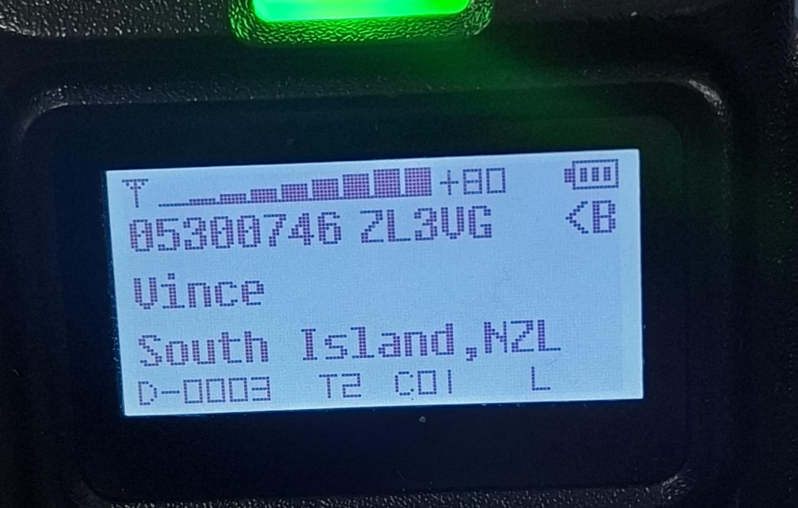
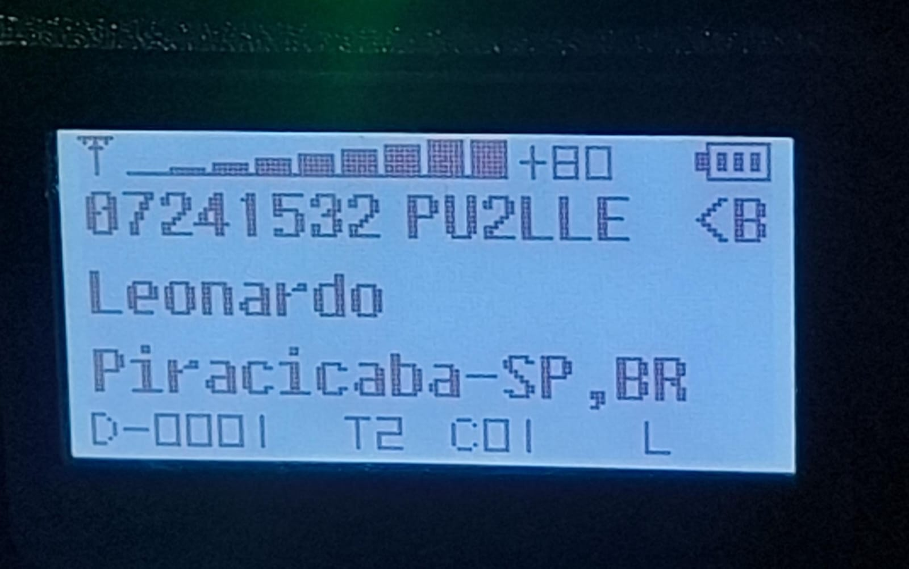

# Formatador de DMR ID - PP5RD

Aplicacao que converte a base de usuarios DMR do **radioid**
(`cbridge_user.csv`) para uma exibicao confortavel na tela do radio
**Radtel RT-4D**.

Acesse: https://dmrid.pp5rd.com.br

## Exemplo (tela do RT-4D)

Resultado no display apos a formatacao - regiao/cidade legivel e sem
caracteres que quebram a tela:

## Como usar
1. Baixe o arquivo `cbridge_user.csv` em https://radioid.net/database/dumps
2. Abra a aplicacao, selecione o arquivo e clique em **Gerar CSV**
3. O CSV formatado e baixado automaticamente

## Como funciona
- 100% no navegador (seus dados nao sao enviados a nenhum servidor).
- Usa **Pyodide** (Python no navegador via WebAssembly) para rodar a mesma
  logica de formatacao da versao desktop (`formatar_dmr.py`), garantindo
  resultado identico.
- Regras aplicadas: sigla/nome de pais, UF/regiao por indicativo, abreviacoes
  de cidade BR, normalizacao ASCII, expansao de UF e tratamento de valores
  genericos ("All Regions").

## Arquivos
- `index.html` - interface
- `app.js` - carrega o Pyodide e orquestra o processamento
- `formatar_dmr.py` - logica de formatacao (compartilhada com a versao desktop)
- `data/regioes_ref.csv` - referencia RADIO_ID -> regiao (enriquecimento)

## Contato
PP5RD - contato@pp5rd.com.br
